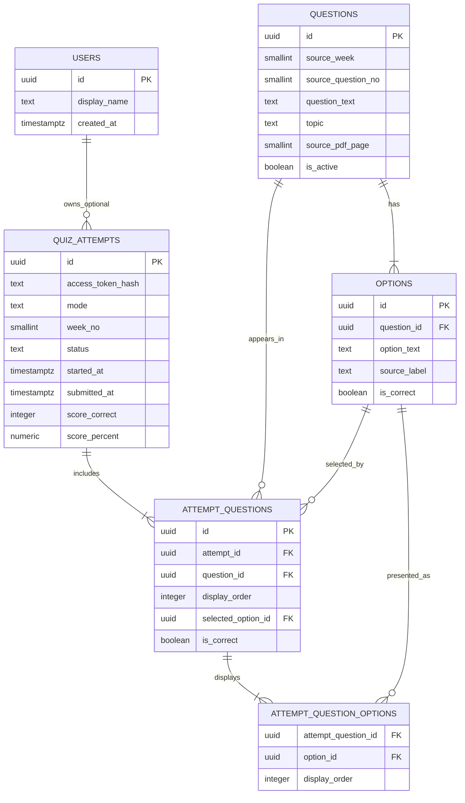

# Backend Database Schema

## 1. Database choice and design principles

Use PostgreSQL with UUID primary keys. The design separates the canonical question bank from an individual attempt’s randomized presentation. The same canonical question can appear in many attempts without rewriting its original options.

Key rules:

- `questions.source_week` is 1–12; each week must have exactly 10 active questions after seeding.
- Every canonical question has exactly four `options` rows and exactly one correct option.
- Correctness is stored against a stable option record, never an A/B/C/D position.
- `attempt_questions.display_order` stores the randomized question order for that attempt.
- `attempt_question_options.display_order` stores the independently randomized option order for each question in that attempt.
- An in-progress attempt keeps the saved order until submitted or abandoned.
- Active-attempt responses must omit correctness data.

## 2. Entity relationship overview



## 3. Tables

### `users` (optional for future authentication)

The MVP can omit registration. Keep `user_id` nullable in attempts if the future account model is anticipated. Do not add login solely to support the 120-question quiz.

| Column | Type | Rule |
|---|---|---|
| `id` | UUID | Primary key |
| `display_name` | TEXT | Optional |
| `created_at` | TIMESTAMPTZ | Required; defaults to current timestamp |

### `questions`

| Column | Type | Rule |
|---|---|---|
| `id` | UUID | Primary key |
| `source_week` | SMALLINT | Required; check 1–12 |
| `source_question_no` | SMALLINT | Required; check 1–10 |
| `question_text` | TEXT | Required, non-empty |
| `topic` | TEXT | Optional; only populate if clearly supported by the source |
| `source_pdf_page` | SMALLINT | Optional but recommended for traceability |
| `is_active` | BOOLEAN | Required, defaults true |
| `created_at` | TIMESTAMPTZ | Required |
| `updated_at` | TIMESTAMPTZ | Required |

Unique key: `(source_week, source_question_no)`.

### `options`

| Column | Type | Rule |
|---|---|---|
| `id` | UUID | Primary key |
| `question_id` | UUID | FK to `questions.id`, cascade delete only during controlled seed replacement |
| `option_text` | TEXT | Required, non-empty |
| `source_label` | TEXT | Optional source label (`a`, `b`, `c`, `d`) for import audit only |
| `is_correct` | BOOLEAN | Required; exactly one true option per question |
| `source_was_bold` | BOOLEAN | Optional audit field; true for the PDF-marked answer |

Constraint: unique `(question_id, id)` to support a composite FK ensuring a selected option belongs to the relevant question. Four-option and one-correct-option requirements must be checked by seed validation and tests (a simple row-level CHECK cannot enforce counts across rows).

### `quiz_attempts`

| Column | Type | Rule |
|---|---|---|
| `id` | UUID | Primary key, random UUID |
| `user_id` | UUID | Nullable FK to `users.id` |
| `access_token_hash` | TEXT | Required for anonymous-attempt access; store a hash, not the raw bearer token |
| `mode` | TEXT | Check `weekly` or `overall` |
| `week_no` | SMALLINT | 1–12 for weekly mode; NULL for overall mode |
| `status` | TEXT | Check `in_progress`, `submitted`, `abandoned` |
| `started_at` | TIMESTAMPTZ | Required |
| `submitted_at` | TIMESTAMPTZ | NULL until submitted |
| `total_questions` | INTEGER | 10 for weekly, 120 for overall; set from actual attempt rows |
| `score_correct` | INTEGER | NULL until submitted; 0–total after submission |
| `score_percent` | NUMERIC(5,2) | NULL until submitted; 0–100 after submission |
| `created_at` | TIMESTAMPTZ | Required |

Check constraint: `(mode = 'weekly' AND week_no BETWEEN 1 AND 12) OR (mode = 'overall' AND week_no IS NULL)`.

### `attempt_questions`

One row per question in a given attempt. Stores question order and submitted answer state.

| Column | Type | Rule |
|---|---|---|
| `id` | UUID | Primary key |
| `attempt_id` | UUID | FK to `quiz_attempts.id`, cascade delete |
| `question_id` | UUID | FK to `questions.id` |
| `display_order` | INTEGER | Required; starts at 1 for each attempt |
| `selected_option_id` | UUID | Nullable until selected |
| `is_correct` | BOOLEAN | NULL until submission; computed on server |
| `answered_at` | TIMESTAMPTZ | NULL until selected |

Unique constraints: `(attempt_id, question_id)` and `(attempt_id, display_order)`. Add `UNIQUE(question_id, id)` to `options` and a composite FK `(question_id, selected_option_id)` referencing `options(question_id, id)` so a client cannot submit an option belonging to another question.

### `attempt_question_options`

Stores the option permutation for each rendered question in each attempt.

| Column | Type | Rule |
|---|---|---|
| `attempt_question_id` | UUID | FK to `attempt_questions.id`, cascade delete |
| `option_id` | UUID | FK to `options.id` |
| `display_order` | SMALLINT | Required; values 1–4 |

Primary key: `(attempt_question_id, option_id)`. Unique `(attempt_question_id, display_order)`. Seed/attempt tests must ensure each attempt-question has exactly the four options belonging to its canonical question.

## 4. PostgreSQL DDL starter

This is a baseline schema; apply it through Alembic migrations rather than repeatedly creating tables by hand.

```sql
CREATE EXTENSION IF NOT EXISTS pgcrypto;

CREATE TABLE users (
  id UUID PRIMARY KEY DEFAULT gen_random_uuid(),
  display_name TEXT,
  created_at TIMESTAMPTZ NOT NULL DEFAULT now()
);

CREATE TABLE questions (
  id UUID PRIMARY KEY DEFAULT gen_random_uuid(),
  source_week SMALLINT NOT NULL CHECK (source_week BETWEEN 1 AND 12),
  source_question_no SMALLINT NOT NULL CHECK (source_question_no BETWEEN 1 AND 10),
  question_text TEXT NOT NULL CHECK (length(trim(question_text)) > 0),
  topic TEXT,
  source_pdf_page SMALLINT CHECK (source_pdf_page BETWEEN 1 AND 26),
  is_active BOOLEAN NOT NULL DEFAULT TRUE,
  created_at TIMESTAMPTZ NOT NULL DEFAULT now(),
  updated_at TIMESTAMPTZ NOT NULL DEFAULT now(),
  CONSTRAINT uq_question_source UNIQUE (source_week, source_question_no)
);

CREATE TABLE options (
  id UUID PRIMARY KEY DEFAULT gen_random_uuid(),
  question_id UUID NOT NULL REFERENCES questions(id) ON DELETE CASCADE,
  option_text TEXT NOT NULL CHECK (length(trim(option_text)) > 0),
  source_label TEXT,
  is_correct BOOLEAN NOT NULL DEFAULT FALSE,
  source_was_bold BOOLEAN NOT NULL DEFAULT FALSE,
  CONSTRAINT uq_option_question_pair UNIQUE (question_id, id)
);
CREATE INDEX ix_options_question_id ON options(question_id);

CREATE TABLE quiz_attempts (
  id UUID PRIMARY KEY DEFAULT gen_random_uuid(),
  user_id UUID REFERENCES users(id) ON DELETE SET NULL,
  access_token_hash TEXT NOT NULL,
  mode TEXT NOT NULL CHECK (mode IN ('weekly', 'overall')),
  week_no SMALLINT,
  status TEXT NOT NULL DEFAULT 'in_progress'
    CHECK (status IN ('in_progress', 'submitted', 'abandoned')),
  started_at TIMESTAMPTZ NOT NULL DEFAULT now(),
  submitted_at TIMESTAMPTZ,
  total_questions INTEGER NOT NULL CHECK (total_questions IN (10, 120)),
  score_correct INTEGER CHECK (score_correct BETWEEN 0 AND total_questions),
  score_percent NUMERIC(5,2) CHECK (score_percent BETWEEN 0 AND 100),
  created_at TIMESTAMPTZ NOT NULL DEFAULT now(),
  CONSTRAINT ck_attempt_mode_week CHECK (
    (mode = 'weekly' AND week_no BETWEEN 1 AND 12 AND total_questions = 10)
    OR (mode = 'overall' AND week_no IS NULL AND total_questions = 120)
  ),
  CONSTRAINT ck_attempt_submission_state CHECK (
    (status = 'submitted' AND submitted_at IS NOT NULL
      AND score_correct IS NOT NULL AND score_percent IS NOT NULL)
    OR (status <> 'submitted' AND submitted_at IS NULL)
  )
);
CREATE INDEX ix_attempts_status_started ON quiz_attempts(status, started_at DESC);

CREATE TABLE attempt_questions (
  id UUID PRIMARY KEY DEFAULT gen_random_uuid(),
  attempt_id UUID NOT NULL REFERENCES quiz_attempts(id) ON DELETE CASCADE,
  question_id UUID NOT NULL REFERENCES questions(id),
  display_order INTEGER NOT NULL CHECK (display_order >= 1),
  selected_option_id UUID,
  is_correct BOOLEAN,
  answered_at TIMESTAMPTZ,
  CONSTRAINT uq_attempt_question UNIQUE (attempt_id, question_id),
  CONSTRAINT uq_attempt_question_order UNIQUE (attempt_id, display_order),
  CONSTRAINT fk_selected_option_for_this_question
    FOREIGN KEY (question_id, selected_option_id)
    REFERENCES options(question_id, id)
);
CREATE INDEX ix_attempt_questions_attempt_order
  ON attempt_questions(attempt_id, display_order);

CREATE TABLE attempt_question_options (
  attempt_question_id UUID NOT NULL
    REFERENCES attempt_questions(id) ON DELETE CASCADE,
  option_id UUID NOT NULL REFERENCES options(id),
  display_order SMALLINT NOT NULL CHECK (display_order BETWEEN 1 AND 4),
  PRIMARY KEY (attempt_question_id, option_id),
  CONSTRAINT uq_attempt_option_order UNIQUE (attempt_question_id, display_order)
);
```

## 5. Validation not expressible with row-level constraints

Run these checks after importing seed data and in CI:

```sql
-- Must return zero rows: every active question must have 4 options and 1 correct answer.
SELECT q.source_week, q.source_question_no,
       COUNT(o.id) AS option_count,
       COUNT(*) FILTER (WHERE o.is_correct) AS correct_count
FROM questions q
LEFT JOIN options o ON o.question_id = q.id
WHERE q.is_active = TRUE
GROUP BY q.id, q.source_week, q.source_question_no
HAVING COUNT(o.id) <> 4
    OR COUNT(*) FILTER (WHERE o.is_correct) <> 1;

-- Must return 12 rows with question_count = 10.
SELECT source_week, COUNT(*) AS question_count
FROM questions
WHERE is_active = TRUE
GROUP BY source_week
ORDER BY source_week;

-- Total active question count must be 120.
SELECT COUNT(*) FROM questions WHERE is_active = TRUE;
```

Also verify each `attempt_question_options` row references an option whose `question_id` matches the associated `attempt_questions.question_id`. Add this integrity check in application/test code or strengthen it with a composite FK if desired.

## 6. As-built differences (Alembic revision `0001_initial_schema`)

The implemented schema follows sections 3–4 with these deliberate changes:

- **`users` table not created.** It is optional for the MVP and no feature uses it; `quiz_attempts.user_id` is therefore also omitted. Add both in a later migration if accounts are introduced.
- **UUIDs are generated by the application** (question/option IDs are deterministic UUID5 values from the seed file; attempt IDs are random UUID4), so the `pgcrypto` extension is not required.
- **At most one correct option per question** is enforced by a partial unique index: `CREATE UNIQUE INDEX uq_options_one_correct ON options (question_id) WHERE is_correct`. "Exactly one" is still enforced by seed validation.
- **Displayed options are tied to the same question at the database level.** `attempt_question_options` has an extra `question_id` column with two composite foreign keys: `(attempt_question_id, question_id) -> attempt_questions(id, question_id)` (requires `UNIQUE (id, question_id)` on `attempt_questions`) and `(question_id, option_id) -> options(question_id, id)`.
- **`seed_imports`** (`seed_sha256` PK, `source_pdf_sha256`, `question_count`, `imported_at`) records each distinct seed file loaded (the import-version marker from section 7).
- `ix_questions_active_week (is_active, source_week)` supports catalogue and attempt queries.
- All timestamps are returned in UTC (the connection sets `timezone=UTC`).

## 7. Deletion and migrations

- Do not hard-delete attempts during normal operation; use retention/cleanup policy if needed.
- Do not edit seeded question/option text casually because results depend on stable records. Use a deliberate seed version or migration for corrections.
- Run schema changes via Alembic. Add an import-version marker/table if repeated seed loads need to be idempotent.
- Do not store the raw anonymous attempt token; store a one-way hash and return the raw token once when the attempt is created.
