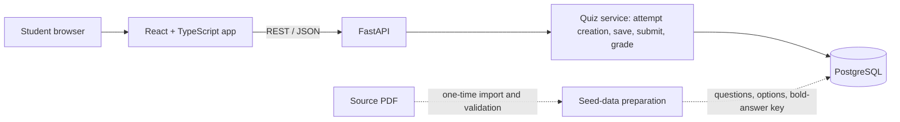

# Technical Requirements and Design (TRD)

## 1. Proposed technology stack

| Layer | Choice | Reason |
|---|---|---|
| Frontend | React, TypeScript, Vite | Fast single-page app with explicit UI states and type-safe API integration. |
| UI styling | CSS Modules or a small utility CSS system | Keep layout responsive without coupling product logic to a component library. |
| Backend | Python 3.12+, FastAPI, Pydantic | Typed request validation and a small REST API. |
| ORM / migrations | SQLAlchemy 2.x + Alembic | Transactional data access and versioned schema. |
| Database | PostgreSQL | Relational integrity for questions, options, answers, and attempts. |
| Testing | pytest; Vitest + React Testing Library; optional Playwright | Unit, integration, and user-flow coverage. |

No runtime PDF service is needed. The PDF is a source artifact used during seed-data preparation.

## 2. Architecture



Responsibilities:

- **Frontend:** catalogue, quiz navigation, radio-option selection, progress state, submit confirmation, and result review. It does not determine scores or receive correctness flags while answering.
- **API:** validates the quiz mode, creates stored random permutations, persists answers, enforces attempt access, grades the submission, and returns result data.
- **Database:** canonical question bank plus immutable attempt-specific order and saved answer state.
- **Seed workflow:** reads question/option text and bold formatting from the PDF, normalizes source labels, and validates all counts before loading.

## 3. Question-bank import workflow

1. Keep the provided PDF as a local, git-ignored source file (as built: `Conservation Geography Week 1 Solutions-merged.pdf` in the repository root, or `data/source/`) and record its checksum. As built, the SHA-256 is recorded in `data/seed/questions.json` and `data/seed/import_validation_report.md`.
2. Extract text while preserving page number, question number, option text, source option label, and font/bold metadata.
3. Normalize each record to `source_week`, `source_question_no`, `question_text`, and exactly four option records.
4. Set `is_correct = true` only for the answer text formatted in bold/dark black in the PDF. Preserve `source_was_bold = true` as an audit field for that option.
5. Do not infer correct answers from the displayed original option letter. The original letters are only import metadata.
6. Validate: 12 weeks; 10 questions per week; 120 questions total; 4 options per question; exactly 1 bold/correct option per question; no blank question/option text; no duplicate `(week, question_number)` records.
7. Manually inspect import exceptions and compare each question with the rendered PDF where extraction boundaries or line wrapping could be ambiguous.
8. Load the validated data through an idempotent seed/import command or controlled migration. As built: `python -m app.cli seed` (upsert by stable UUID5 IDs; `seed_imports` records each seed file hash).
9. Store an import report with counts, source checksum, and any unresolved exceptions. Do not start the app with a partially loaded bank.

**As built:** `scripts/extract_questions.py` implements steps 2–7 and writes `data/seed/questions.json`, `answer_key_audit.csv` and `import_validation_report.md`. A question is `verified` only when (a) exactly one option is fully set in `Calibri,Bold`, (b) that option's rendered stroke width is at least 1.15x every other option in the question, and (c) its text matches the table below. All 26 rendered pages were also compared manually (`data/seed/manual_visual_review.md`). Result: 120/120 verified, 0 unresolved. Attempt creation returns `503 question_bank_invalid` if the active bank for the requested scope fails count checks.

Do not create explanations from outside knowledge. They are not present in the source requirements.

## 4. Answer-key audit from the PDF

The table below records the **answer text marked bold in the provided PDF**, ordered by source week/question. It is for seed validation only. At runtime, grade by the matching option ID, not by this table or by A/B/C/D position.

### Week 1

| Q | PDF-bolded answer text |
|---:|---|
| 1 | migration |
| 2 | Alexander von Humboldt |
| 3 | allelopathy |
| 4 | Habitat degradation |
| 5 | ecology |
| 6 | Liebig’s law of the minimum |
| 7 | together |
| 8 | to keep |
| 9 | Meteorology |
| 10 | pull factor |

### Week 2

| Q | PDF-bolded answer text |
|---:|---|
| 1 | Stratovolcano |
| 2 | Mantle |
| 3 | inclusion study |
| 4 | Small bodies formed from gas and dust that can accrete into planets |
| 5 | Shield volcano |
| 6 | They are longitudinal in nature |
| 7 | Principle of fossil succession |
| 8 | Mercury, Venus, Earth, Mars |
| 9 | Principle of lateral continuity |
| 10 | Flood basalt province |

### Week 3

| Q | PDF-bolded answer text |
|---:|---|
| 1 | siliciclastic rock |
| 2 | chemical weathering |
| 3 | amphiboles |
| 4 | chemical weathering |
| 5 | deposition |
| 6 | Streak shows the colour of the powdered mineral and may reduce the effect of minor impurities |
| 7 | Stability of sea level |
| 8 | siliciclastic rock |
| 9 | cleavage |
| 10 | coarse grained igneous rocks |

### Week 4

| Q | PDF-bolded answer text |
|---:|---|
| 1 | mitigation |
| 2 | sea level |
| 3 | adaptation |
| 4 | resilience to climate changes |
| 5 | Stratosphere |
| 6 | advection |
| 7 | 30 years |
| 8 | Mesosphere |
| 9 | the weight of air above the point of measurement |
| 10 | mT |

### Week 5

| Q | PDF-bolded answer text |
|---:|---|
| 1 | Clay and silt |
| 2 | abyssal plain |
| 3 | mid-oceanic ridge |
| 4 | They receive both light and nutrients |
| 5 | The difference between sea level at high tide and low tide |
| 6 | Sublimation |
| 7 | Hydrostatic pressure, salinity and temperature |
| 8 | submarine canyon |
| 9 | 0-1 degree |
| 10 | isohaline curves |

### Week 6

| Q | PDF-bolded answer text |
|---:|---|
| 1 | water on opposite sides flows in different directions |
| 2 | accordant |
| 3 | dendritic drainage |
| 4 | discordant drainage |
| 5 | sedimentary rocks |
| 6 | Narmada and Tapi |
| 7 | all of these |
| 8 | their courses are cut into older, harder rocks |
| 9 | F |
| 10 | all of these |

### Week 7

| Q | PDF-bolded answer text |
|---:|---|
| 1 | Arid soils |
| 2 | physical weathering |
| 3 | alluvial soil |
| 4 | alpha (α) biodiversity |
| 5 | catastrophic climax |
| 6 | intermediate |
| 7 | gamma (γ) biodiversity |
| 8 | soil profile |
| 9 | chemical weathering |
| 10 | Soil structure |

### Week 8

| Q | PDF-bolded answer text |
|---:|---|
| 1 | Seed bank |
| 2 | Inbreeding depression |
| 3 | Keystone species |
| 4 | limited geographical range |
| 5 | Captive-bred individuals may find reintroduction difficult |
| 6 | Species richness |
| 7 | biomagnification |
| 8 | medium |
| 9 | pollination |
| 10 | all of the above |

### Week 9

| Q | PDF-bolded answer text |
|---:|---|
| 1 | Female population divided by male population multiplied by 1000 |
| 2 | possibilism |
| 3 | working-age population |
| 4 | S-shaped |
| 5 | war |
| 6 | GDP per capita |
| 7 | trans-boundary sustainability |
| 8 | high birth rate, high death rate to low birth rate, low death rate |
| 9 | foresight |
| 10 | 15-64 years |

### Week 10

| Q | PDF-bolded answer text |
|---:|---|
| 1 | soil organic matter |
| 2 | stock resources |
| 3 | allowing easier human access into forest areas |
| 4 | potential resources |
| 5 | global calorie supply |
| 6 | reserve resources |
| 7 | stock resources |
| 8 | mobile sources |
| 9 | actual resources |
| 10 | animal manure |

### Week 11

| Q | PDF-bolded answer text |
|---:|---|
| 1 | absolute advantage |
| 2 | all of these |
| 3 | Railways |
| 4 | all of these |
| 5 | all of these |
| 6 | comparative advantage |
| 7 | Nuclei for condensation |
| 8 | They cause light pollution through headlamps |
| 9 | To reduce conflict and avoid inbreeding |
| 10 | educational town |

### Week 12

| Q | PDF-bolded answer text |
|---:|---|
| 1 | vulnerability |
| 2 | 1500 m |
| 3 | Interpretive application |
| 4 | hazard |
| 5 | Inertial measurement unit |
| 6 | Metric application |
| 7 | Humanware |
| 8 | market price method |
| 9 | Oblique |
| 10 | Ground-borne platform |

**Audit note:** These values are transcription checks derived from PDF bold formatting. During import, the selected correct option must be matched to the corresponding option row for that exact question. Do not rely on the text alone if two options are identical; such duplicates should be flagged for manual review. Retain PDF wording even where a subject-matter reviewer might question it until an explicit correction is approved.

## 5. API contract

Base path: `/api/v1`. JSON request/response bodies. All attempt-specific routes require an attempt access token (for example, an `Authorization: Bearer ...` header) and ownership validation.

### `GET /health`

Returns service health and database connectivity status. Must not expose secrets or connection strings.

### `GET /quizzes`

Returns weekly quiz metadata and overall quiz metadata. Example:

```json
{
  "weeks": [
    { "week_no": 1, "question_count": 10, "title": "Week 1" }
  ],
  "overall": { "question_count": 120, "title": "Overall Quiz" }
}
```

API implementation must return all 12 weeks; the example only illustrates the shape.

### `POST /attempts`

Create an attempt. Request:

```json
{ "mode": "weekly", "week_no": 3 }
```

For overall mode:

```json
{ "mode": "overall" }
```

Validation: `weekly` requires `week_no` 1–12; `overall` requires `week_no` absent/null. The backend generates a high-entropy access token, stores only its hash, creates attempt rows and both shuffled orders inside a transaction, and returns the token only at creation. New attempt response contains only public question/option fields, never correctness flags.

### `GET /attempts/{attempt_id}`

Returns the saved attempt with questions in stored `display_order`, options in stored `display_order`, selected option IDs and progress state. Must not reshuffle or disclose correct answers before submission.

### `PUT /attempts/{attempt_id}/questions/{attempt_question_id}/answer`

Request:

```json
{ "selected_option_id": "uuid-or-null" }
```

The backend verifies that the attempt is in progress and the selected option belongs to that question. `null` clears an answer. Return saved answer state and current answered count, but no correctness flag.

### `POST /attempts/{attempt_id}/submit`

The server performs grading and status transition in one transaction (the attempt row is locked with `SELECT ... FOR UPDATE`, which also serialises it against answer saves). It rejects any request body with `422 unexpected_fields`, so client-supplied scores are never accepted. If already submitted, return the existing result. The response includes the score and full review with correct answer text.

### `GET /attempts/{attempt_id}/result`

Allowed only when submitted. Returns result summary and question-by-question review. A result route before submission returns a conflict/not-ready response and no correct answers.

### API error format

Use consistent JSON error responses with a stable machine-readable `code`, a readable `message`, and optional field details. As built: `{"error": {"code": "...", "message": "...", "details": ...}}`. Codes include `missing_token` (401), `invalid_token` (403), `attempt_not_found` / `question_not_in_attempt` (404), `attempt_not_in_progress` / `attempt_not_submitted` (409), `validation_error` / `option_not_in_question` / `unexpected_fields` (422), and `question_bank_invalid` (503). Use 400/422 for invalid input, 401/403 for missing/invalid access, 404 for unknown resource, 409 for invalid state transitions, and 5xx for unexpected server errors.

## 6. Shuffle algorithm and persistence

At new attempt creation:

1. Query all active questions for the requested week or all active questions for overall mode.
2. Validate expected count: weekly = 10; overall = 120. Abort if content validation fails.
3. Shuffle question IDs server-side using a cryptographically sound or standard unbiased Fisher–Yates shuffle (a secure random source is preferred).
4. Insert one `attempt_questions` row per question with a unique `display_order`.
5. For each attempt-question, independently shuffle its four option IDs and insert the resulting `attempt_question_options` order.
6. Commit attempt, question ordering and option ordering in one transaction.
7. Return the newly created attempt with persisted display orders.

Do not re-run the shuffle on `GET`, `PUT answer`, navigation, browser refresh, or result retrieval. A different order on every new attempt is a probabilistic expectation, not a promise that no two permutations will ever coincide. If tests need a deterministic permutation, inject a test-only random source.

## 7. Grading and scoring

- On submit, load all attempt questions and canonical options in a transaction.
- For every question, compare `selected_option_id` to the option row where `is_correct = true` for the same question.
- Set `attempt_questions.is_correct` to true/false; unanswered questions become false for score purposes and remain distinguishable by `selected_option_id IS NULL`.
- Compute `score_correct`, `total_questions`, and `score_percent = round(score_correct * 100.0 / total_questions, 2)`.
- Set `submitted_at` and status to `submitted` only once.
- Return a detailed review after the transition. Do not reveal correct answer IDs/text while in progress.

## 8. Frontend design boundaries

- Define typed interfaces for `QuizCatalogue`, `Attempt`, `AttemptQuestion`, `DisplayedOption`, `AnswerUpdate`, and `AttemptResult`.
- Use stable IDs for React keys and selected values. Never use index or A/B/C/D letter as a key.
- Keep selected answers in UI state for immediate feedback, but treat backend state as authoritative and show save failure states.
- The frontend displays labels A–D according to the returned option order; it sends the selected option UUID.
- Do not place `is_correct` in the active attempt payload or front-end seed JSON.

## 9. Test strategy

### Unit tests

- Mode validation and source-week filtering.
- Shuffle returns every input item once and never mutates the canonical source list.
- Grade by option UUID, independent of displayed position.
- Score percentage calculation and rounding.

### Integration tests

- Each week creates 10 questions from exactly that week.
- Overall creates all 120 distinct questions exactly once.
- Every attempt-question has four options and each belongs to the same canonical question.
- Reloading the same attempt returns the exact same question/option orders.
- API response before submission contains no correct flags, IDs, or answer-key text.
- Invalid/cross-question option IDs are rejected.
- Unanswered questions score zero and show `Not answered`.
- Duplicate submissions return the original saved result.
- Correct answer is graded correctly when displayed first, second, third, or fourth.

### End-to-end tests

At minimum, run one weekly path and one overall path: start, answer some questions, navigate, refresh, resume, submit, and inspect results. Verify the overall screen can navigate to the final question and that all 120 questions are counted.

## 10. Deployment and configuration

- Keep database URL, secret/token settings, and environment configuration in environment variables, never committed to Git.
- Use a separate test database for CI; do not rely on developer-local state.
- Provide schema migrations and a repeatable seed/import command.
- Add a health endpoint and log attempt lifecycle events without logging raw bearer tokens.
- Document a production start command and frontend/backend origins/CORS configuration.
