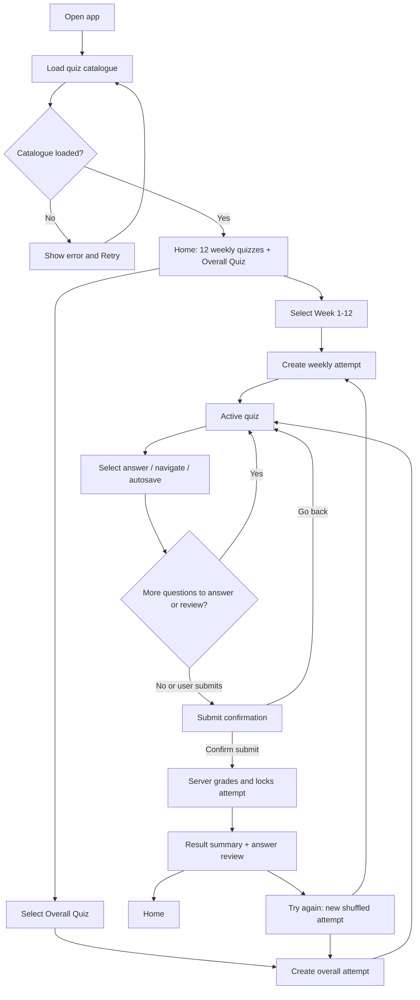
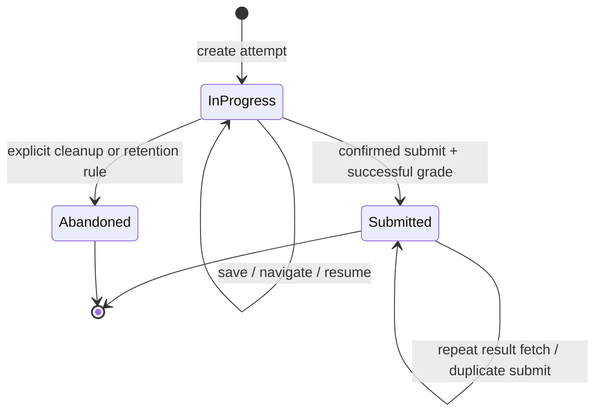

# Web App Flow

## 1. High-level navigation



## 2. Starting a weekly quiz

1. The app requests `GET /api/v1/quizzes`.
2. The user selects Week N.
3. The frontend sends `POST /api/v1/attempts` with `{ "mode": "weekly", "week_no": N }`.
4. The backend verifies there are 10 active questions for Week N, creates the attempt, shuffles those question IDs, independently shuffles the four options per question, persists both orders, and returns the public attempt payload plus an access token.
5. The frontend displays Question 1 of 10 and the stored sequence. It must not reorder returned data on its own.

## 3. Starting the overall quiz

1. The user selects Overall Quiz.
2. The frontend sends `POST /api/v1/attempts` with `{ "mode": "overall" }`.
3. The backend verifies there are 120 active questions in total and creates an attempt containing every active question exactly once.
4. The backend randomizes the order of all 120 questions and independently randomizes each question's four options.
5. The frontend shows Question 1 of 120 with navigation/progress support. Question navigation must not require downloading or rendering every result view at once, although loading the complete 120-question attempt is acceptable for this small bank.

## 4. Answer and navigation flow

1. The learner selects an option.
2. The frontend updates selected state immediately and sends the selected option UUID to the answer endpoint.
3. The backend verifies the attempt is `in_progress`, confirms that the option belongs to the current question, saves the selected option, and returns save status/progress.
4. The user can navigate to previous/next questions or jump via the question palette.
5. When the app is refreshed or reopened, it loads the same attempt ID and token. The server returns the saved question order, option order, and selected values without re-shuffling.
6. If a save fails, the app must show the failure and allow retry; it must not silently mark the answer as safely persisted.

## 5. Submission and result flow

```mermaid
sequenceDiagram
  actor Learner
  participant UI as React UI
  participant API as FastAPI
  participant DB as PostgreSQL
  Learner->>UI: Click Submit
  UI->>Learner: Show answered/unanswered count
  Learner->>UI: Confirm submission
  UI->>API: POST /attempts/{id}/submit
  API->>DB: Begin transaction; lock attempt
  API->>DB: Grade selected option IDs
  API->>DB: Save correctness, score, submitted_at, status
  API->>DB: Commit transaction
  API-->>UI: Summary + answer review
  UI-->>Learner: Show result and correct answers
```

Rules:

- An attempt is submitted only after explicit confirmation.
- All grading happens on the server and within a database transaction.
- Correct answers are not included in active-attempt responses.
- Duplicate submit requests return the same stored result.
- After submission, answer editing is disabled.
- A “Try again” action creates a new attempt and therefore new random permutations.

## 6. Resume and expired access

- Store the attempt ID and raw access token in a suitable client-side mechanism for the active attempt; never store the token in logs or embed it in a public URL where it can leak. Prefer a secure same-site cookie if the deployment supports it; otherwise document the risk of browser storage and keep the token scoped to one attempt.
- On resume, the API validates the token against the stored hash and returns the saved attempt.
- If the access token is missing/invalid or the attempt no longer exists, show a clear message and a link back to quiz selection. Do not silently create another attempt because that would reset the user's progress unexpectedly.
- **As built:** the token is kept in `localStorage` (one record per attempt), sent as `Authorization: Bearer`, and never placed in a URL. The attempt URL is `/attempts/{id}` with an optional `?q=N` for the current question. The home page offers **Resume** for an unsubmitted attempt stored in this browser alongside **Start new**. Opening an attempt in another browser shows the recovery message. Risk accepted: anyone using the same browser profile can resume that attempt.

## 7. State transitions



## 8. Failure and recovery flows

- **Catalogue unavailable:** show retry; do not show misleading empty counts.
- **Attempt creation fails:** stay on the home page and show a retry action.
- **Answer save fails:** preserve the current selection in UI state, mark it unsaved, and retry safely. Before submission, warn if saves are pending or failed.
- **Submit response times out:** request the attempt result/status again. Because submission is idempotent, do not start a second attempt automatically.
- **Question-bank validation fails:** fail deployment/seed job clearly; do not launch a quiz with missing questions or answers.
